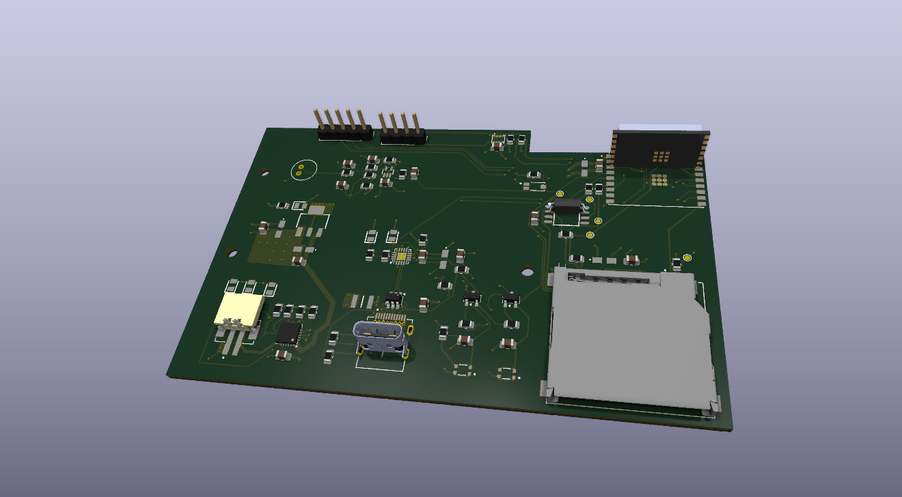

# ESP32-C3 Sensor Board

It has been designed in KiCad as part of the Udemy course *Advanced PCB Design with KiCad 9*.(udemy.com/course/advanced-pcb-design-with-kicad/)
The design follows the course. 
I did the schematic capture, layout, and fabrication outputs.

## Features

- **MCU:** ESP32-C3-WROOM-02 (Wi-Fi / BLE), external 32 Mbit SPI flash (W25Q32JV)
- **USB:** USB-C, CP2102N USB-UART bridge, USBLC6-2SC6 ESD protection, resettable fuse
- **Power:** MCP73871 Li-Po charger with power-path management, LM1117 3.3 V LDO, JST-PH battery connector
- **Sensors:** BME280 (temperature / humidity / pressure), TEMT6000 ambient light, electret microphone with MAX4466 amplifier
- **Storage / UI:** microSD slot, status LEDs, Boot and Reset buttons
- **Debug:** test points on the SPI bus, pin headers for expansion

The custom footprint library "ESP32_Project_Footprints" and its 3D models were provided by the course and are not redistributed here. 
The footprints are embedded in "Demo.kicad_pcb", so the layout opens. 
Updating the PCB from the schematic requires the original library.

(Design only, not fabricated or tested.)
